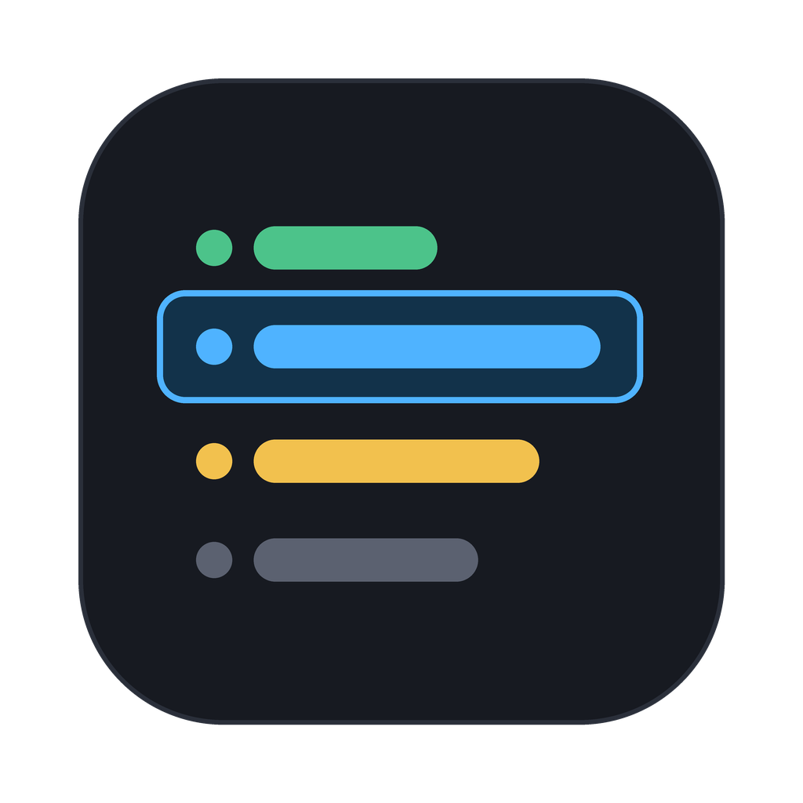
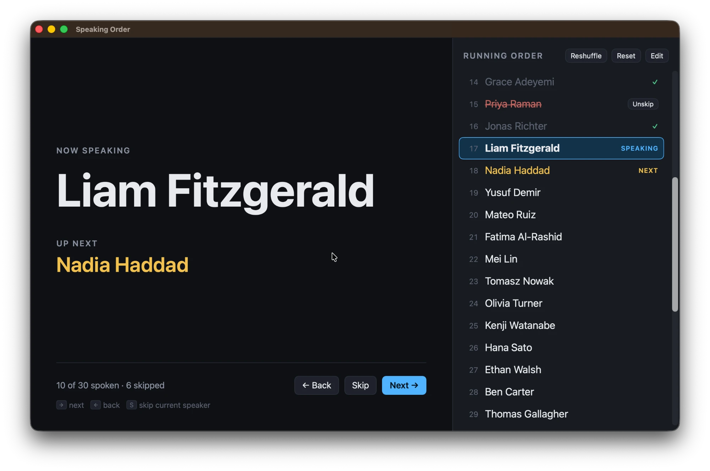

<p align="center">
  
</p>

<h1 align="center">Speaking Order</h1>

<p align="center">
  A small native macOS app that shuffles a meeting's attendees into a random speaking order and steps through it.
</p>

---

Paste in everyone's name, press **Randomise & start**, and the app shows who's
speaking now and who's next. You can skip or defer people, step back, reshuffle,
and go full screen for screen-sharing. It's a single-window SwiftUI app with no
dependencies, and the built app is under 1 MB.



## Requirements

- A Mac with **Apple silicon** (M1 or later)
- **macOS 14 Sonoma** or later
- **Xcode Command Line Tools** (the full Xcode app isn't needed)

## Building

1. Install the Command Line Tools if you don't have them:

   ```bash
   xcode-select --install
   ```

2. Clone the repository and run the build script:

   ```bash
   git clone https://github.com/isambard-sc/SpeakingOrder.git
   ```

   ```bash
   cd SpeakingOrder
   ```

   ```bash
   ./build.sh
   ```

   This compiles the Swift sources, builds the app icon from `icon.png`,
   bundles everything into `Speaking Order.app`, and ad-hoc signs it.

3. Move the app into Applications:

   ```bash
   mv "Speaking Order.app" /Applications/
   ```

You built and signed it on your own Mac, so Gatekeeper won't block it.

### Building by hand

`build.sh` uses only the standard command-line tools. The compile step is:

```bash
swiftc -O -parse-as-library -target arm64-apple-macos14.0 \
  SpeakingOrderApp.swift Meeting.swift Theme.swift SetupView.swift MeetingView.swift \
  -framework SwiftUI -framework AppKit \
  -o SpeakingOrder
```

After that, the script copies `Info.plist` in, converts `icon.png` to
`AppIcon.icns` with `sips` and `iconutil`, and signs the bundle with
`codesign --sign -`.

## Usage

- **Names:** paste them one per line. Bullets, numbering and other symbols are stripped.
- **Keyboard:** → or ↓ next, ← or ↑ back, **S** skip.
- **Running order:** hover over a name to **Defer** them (move to the bottom) or **Skip** them.
  **Reset** unskips everyone. **Reshuffle** keeps skipped people skipped.
- **Menus:**
  - **Meeting:** Next, Back, Skip, Reshuffle (⌘R), Reset Skipped, Edit Names (⌘E)
  - **View:** Zoom In (⌘+), Zoom Out (⌘−), Actual Size (⌘0), Enter Full Screen (⌃⌘F)
- **Saving:** closing the window quits the app. The current meeting is saved and
  picks up where you left off next time. Window size, position and zoom are remembered too.

## Project layout

| File | Purpose |
| --- | --- |
| `SpeakingOrderApp.swift` | App entry point, window and menus |
| `Meeting.swift` | Meeting model, actions, keyboard handling and saving |
| `SetupView.swift` | Screen for entering names |
| `MeetingView.swift` | Screen for running the meeting |
| `Theme.swift` | Colours, button style and small shared views |
| `Info.plist` | Bundle metadata |
| `icon.png` | Source image for the app icon |
| `build.sh` | Compiles, bundles, makes the icon and ad-hoc signs |

### Notes for contributors

- There's deliberately no Xcode project or Swift package, so the app builds
  with the Command Line Tools alone.
- SwiftUI's `@State` is a compiler macro, and the Command Line Tools don't ship
  the macro plugin. The code uses the `State` type directly instead
  (`private let hovering = State(initialValue: false)`). Please keep it that way
  so `build.sh` keeps working without Xcode.
- To build for Intel Macs, change `-target` in `build.sh` to
  `x86_64-apple-macos14.0`. For a universal binary, build both targets and
  merge them with `lipo -create`.

## License

Released under the [MIT License](LICENSE).
